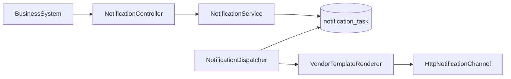

# 设计说明

业务系统通过 `POST /api/v1/notifications` 提交通知。服务把请求写入 `notification_task` 后立即返回，由 `NotificationDispatcher` 按供应商模板渲染 HTTP 请求并发送。

## 接入

业务系统只调这一个接口，不等待第三方响应，受理结果是 HTTP 202。

`targetSystem` 必须是已启用的供应商编码。未知或停用的供应商拒绝受理。相同 `requestId` 返回已有任务，不重复落库；`request_id` 有唯一索引。

## 投递与重试

投递语义是至少一次。请求先落库，调度器再发送，进程退出不会丢掉已受理的任务。

调度器拉取状态为 `PENDING`、以及 `nextRetryTime` 已到的 `FAILED`。同一批内按 `priority` 从高到低、创建时间从早到晚取出。没有独立的优先级队列或限流。

`HttpNotificationChannel` 以 HTTP 2xx 为成功，任务变为 `SUCCESS`。其它状态码和网络异常记为失败：`retryCount` 加一，状态变为 `FAILED`，并按 `notify-hub.retry-intervals-minutes` 设置下次时间。次数超过列表长度后变为 `DEAD`。当前配置是每分钟一次、共 5 次。未配置时，代码默认间隔是 `1,5,30,60,360`。

任务详情页只把 `DEAD` 放回 `PENDING`，并清掉重试次数和最近错误。其它状态不能重放。

## 供应商模板

地址、方法、请求头和报文体存在 `notification_vendor`。调度时用 `VendorTemplateRenderer` 渲染，不在代码里按供应商写死报文。

| 占位符 | 含义 |
|--------|------|
| `{{eventType}}`、`{{requestId}}` | 按字符串插入，模板里自己写引号 |
| `{{payload}}` | 插入整段 JSON |
| `{{payload.字段}}` | 插入该字段的 JSON 值 |

请求头是 JSON 对象。留空则使用 `Content-Type: application/json`。提交报文里的 headers 覆盖同名模板请求头。渲染后的 body 必须是合法 JSON，地址必须以 `http://` 或 `https://` 开头。

`notify-hub.channels` 只在供应商表为空时写入 CRM、AD、INVENTORY 三条种子，并在启动时把仍指向 `localhost:18081`、`18082`、`18083` 的地址改写到当前根地址。表里已有的其它地址不会被 yml 覆盖。

| 编码 | 方法与路径 | Body |
|------|------------|------|
| CRM | `POST {base}/contacts/update` | `{"event":"{{eventType}}","contact":{{payload}}}` |
| AD | `POST {base}/conversions` | `{"conversion_event":"{{eventType}}","data":{{payload}}}` |
| INVENTORY | `POST {base}/stock/adjust` | `{"event_type":"{{eventType}}","items":{{payload}}}` |

要投到真实系统，在供应商页面改地址和报文，改完不用重启。

## 不负责的事

- 不保证恰好一次。超时后无法判断对方是否已处理，第三方接口需要自己做幂等。
- 不回滚业务事务。支付成功但通知失败时，支付状态保持不变。
- 不解释第三方的业务失败。非 2xx 一律按投递失败重试或进入死信。
- 不使用消息队列，也不提供指标和告警。失败和死信写在任务状态和日志里。
